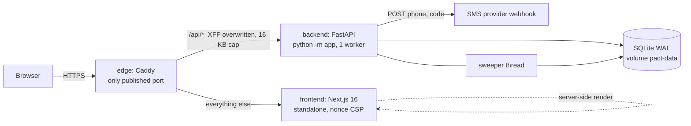

# Architecture

## System



Trust boundaries: the internet ends at the edge. The edge is the only component that decides the client IP (`X-Forwarded-For` is overwritten with the real peer and the backend, with `TRUSTED_PROXY_HOPS=1`, believes only that last hop). Backend and frontend are not published to the host. In local development there is no edge: Next rewrites `/api` to the backend and every client shares one IP, which is acceptable for development only.

## Backend (`backend/app`)

| Module | Responsibility |
|---|---|
| `config.py` | Frozen `Settings` read from the environment; refuses an admin token under 32 chars and non-http(s) SMS URLs. |
| `db.py` | One short-lived connection per use (`BEGIN IMMEDIATE` for writes), idempotent migrations (`PRAGMA user_version`), demo seed. |
| `domain.py` | Pure settlement math and the SQL that feeds it. No HTTP. Shared 5 s snapshot. |
| `security.py` | `Limiter` (fixed windows, bounded, fail-closed), `peer_ip`, and `Guards`: a pure-ASGI middleware for body cap, CSRF, rate limit, headers, request id, access log. |
| `obs.py` | JSON logging, request id context, hashed phone references. |
| `routes/` | `auth` (OTP, sessions, account), `pacts` (dashboard, create, cancel, check-in), `wallet`, `community` (board, business, demo close, admin settle). |
| `__main__.py` | `python -m app`: the supported entry point; pins `proxy_headers=False`, one worker, bounded concurrency. |

### Data model

`users(id, name, name_en, balance, points, phone UNIQUE)` · `pacts(user_id, type, target_days, stake, daily_goal, active, created, ends)` with a partial unique index so a user has at most one active pact per type · `checkins(pact_id, day, value, note)` · `txns(user_id, amount, kind, day)` · `settlements(week PK, pool, fee, charity, winners)` · `sessions(token_hash PK, user_id, expires)` · `otps(phone PK, code_hash, expires, tries, locked_until, win_start, sent)` · `meta(k, v)` (holds the ledger `epoch`) · `redemptions`.

Indexes serve the three hot reads: `checkins(day, pact_id)` (the week scan), `checkins(pact_id, day)` (one user's history and streak), `pacts(user_id, active)`.

### Time

All dates use `Asia/Tehran` (`APP_TZ`). The week runs Saturday to Friday. A week is settled once, after it ends, by the sweeper (every 10 minutes) or by `POST /api/admin/settle`. Weeks before the first boot of a database are never settled retroactively (`meta.epoch`).

### Settlement rules (`domain.settle`)

1. A missed day costs `stake`. Nobody pays more than their balance; a shortfall is shared pro rata across that user's pacts.
2. The pool is the sum of those losses. `fee = pool × 12 %`.
3. Winners (every target day done) share `pool − fee` by **exposure** `stake × target_days`, each capped at **3× their own exposure**. The remainder goes to charity.
4. Invariant, tested on 500 random weeks: `Σ deltas + fee + charity = 0`, and no user's losses exceed their balance.
5. After settlement, cancelled pacts end, and pacts whose owner can no longer cover a full week of exposure are paused.

Exposure weighting and the 3× cap are an **owner decision** (they bound last-day pool farming; they do not remove it while check-ins are self-reported).

### Authentication flow

```mermaid
sequenceDiagram
  participant U as Browser
  participant A as API
  participant S as SMS provider
  U->>A: POST /api/auth/otp {phone}
  A->>A: limits: ip 10/10min, phone 3/10min, daily 10, global budget
  A->>S: {phone, code} (5 s timeout)
  U->>A: POST /api/auth/verify {phone, code}
  A->>A: constant-time compare; 5 wrong guesses lock the phone 15 min (resend does not reset)
  A-->>U: Set-Cookie __Host-sid (HttpOnly, Secure, SameSite=Strict); only sha256(token) is stored
```

### Concurrency and failure behaviour

SQLite in WAL mode; every state-changing request takes the write lock up front, reads what it needs **inside** that lock, and commits or rolls back as one unit. Settlement is one transaction and is idempotent (`settlements.week` is the primary key), so a crash mid-sweep re-runs cleanly. The sweeper runs in a daemon thread; if it fails it logs `sweep_failed` and retries in 10 minutes. If the SMS provider is down, login answers 503 `sms_unavailable` and nothing else is affected.

## Frontend (`frontend`)

Next.js 16 App Router, React 19, Tailwind 4. `proxy.ts` mints a nonce per request for a strict CSP. `lib/api.ts` is a stale-while-revalidate client (any 401 returns the user to sign-in; the server's CSRF rule needs `content-type: application/json`, which the client always sends). `lib/auth.tsx` owns the session state; `components/Shell.tsx` gates routes and keeps the aggregate-only `/business` page public. `lib/i18n.tsx` holds both dictionaries (Persian wording follows the UX vocabulary guide) and renders Persian digits and the Persian calendar via `Intl`.

### Design system (Apple HIG principles, see `~/.claude/skills/apple-design`)

- **Motion**: sheets are springs (damping 1.0 by default, 0.8 only after a flick), start from the current value and velocity, project a flick to decide dismissal and rubber-band past the top edge. Everything else animates `transform`/`opacity` only.
- **Materials**: translucent blur is reserved for floating chrome (sidebar, header, tab bar, sheets). Cards are plain translucent fills. `prefers-reduced-transparency` makes surfaces solid, `prefers-contrast: more` hardens borders and text, `prefers-reduced-motion` stops the aurora and entrances.
- **Typography**: tracking is script-specific (tightened for large Latin headings, never applied to Persian, where it breaks letter joining); sizes are `rem`.
- **Feedback and agency**: hold-to-seal for the one irreversible action, with a normal-click path for keyboard and assistive tech; confirm sheets for cancel, delete and the demo week close; status is never colour-only.

## Performance design

| Concern | Decision |
|---|---|
| Security guard cost | Pure ASGI, no per-request task; one dict lookup per limiter key; headers appended once. |
| Rate limiter memory | Bounded (100k keys); expired windows are dropped; fail-closed when full. |
| Pool / board / business | One shared snapshot per 5 s, single-flight, TTL-only (no invalidate-on-write storm). A user's own data is always fresh. |
| DB | `synchronous=NORMAL` with WAL, indexes matching the three hot queries, 3 queries per `pacts_view` regardless of pact count. |
| Frontend idle cost | No filter blur, no infinite JS timers; the aurora is one compositor-only layer. Measured idle: 0 ms script, 0 ms layout over 5 s. |
| Frontend loading | Only the active script's font file loads (2 files, 81 KB for Persian); stale-while-revalidate so revisited pages paint instantly. |
| Count-up | Writes to the text node, no React render per frame. |

Measured with `scripts` / a synthetic dataset (3,000 users, 6,000 pacts, 720k check-ins), CPU time on a heavily loaded host: a user's dashboard queries 0.2 ms, streak 1.2 ms, shared snapshot hit ~0 ms, snapshot refresh ~325 ms per 5 s at that size.

## Configuration

| Variable | Default | Meaning |
|---|---|---|
| `DEMO` | `0` | Demo users, echoed OTP, fake top-up, manual week close, API docs. Never in production. |
| `ADMIN_TOKEN` | unset | ≥ 32 chars enables `POST /api/admin/settle` (edge blocks it from outside). |
| `SMS_WEBHOOK_URL` | unset | Receives `{"phone","code","text"}`; unset outside DEMO means login answers 503. |
| `TRUSTED_PROXY_HOPS` | `0` | Number of reverse proxies appending to `X-Forwarded-For` (compose sets 1). |
| `RATE_LIMIT_PER_MIN` / `SMS_HOURLY_BUDGET` | 300 / 300 | Per-IP API budget; global SMS sends per hour. |
| `COOKIE_SECURE` | `1` (`0` in DEMO) | Secure + `__Host-` cookie. |
| `APP_TZ` / `DB_PATH` / `LOG_LEVEL` | `Asia/Tehran` / `pact.db` / `INFO` | |

## Ceilings and upgrade path

One backend process: the limiter and snapshot are in memory. To scale out, move the limiter to Redis and the database to Postgres (the SQL is plain; the settlement transaction maps directly). Settlement of 6,000 pacts takes about a second inside one write transaction; at that size, move it to an off-peak job and settle in batches. Snapshot refresh cost grows with the week's check-ins; a daily-totals table is the next step.
